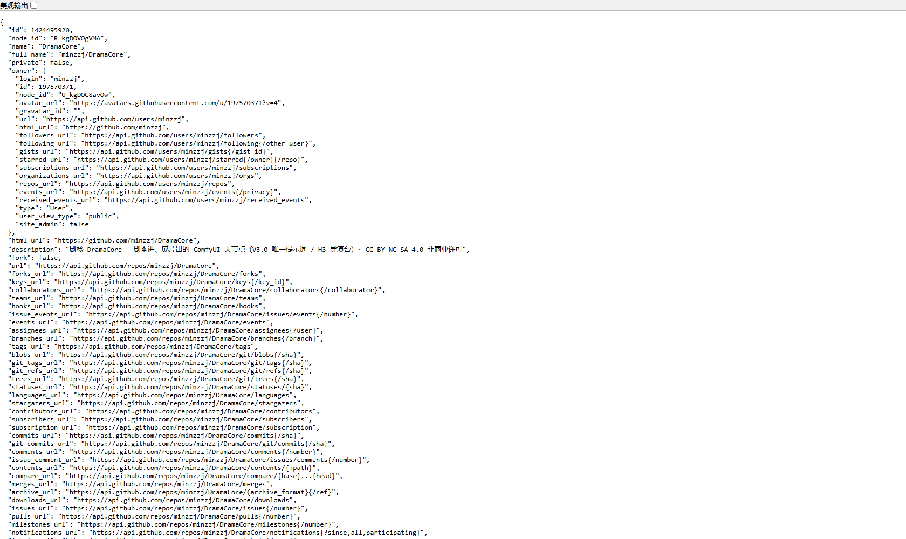

# 剧核 DramaCore（Better ComfyUI）

**Language** · **简体中文** | [English](README_EN.md)

> **剧本进，成片出。** 一个 ComfyUI 大节点完成：剧本 → 提示词 → 素材 → H3 导演台 → 审核 → 剪辑成片。
> 许可 **CC BY-NC-SA 4.0**：可下载、可修改、可非商业再分发；**禁止商用**；修改后必须同许可开源。

**版本频道**

| 频道 | 版本 | 定位 | 下载 |
|---|---|---|---|
| 🟢 **正式版（稳定）** | `v0.2.0-internal` | 默认使用；昨晚已测试通过的稳定链路 | [正式版 ZIP](https://github.com/minzzj/DramaCore/releases/download/v0.2.0-internal/DramaCore-v0.2.0-internal.zip) |
| 🟡 **内测版（公测）** | `v0.3.0-beta.1` | 更快 + 效果更好；**可能不稳定** | [内测版 ZIP](https://github.com/minzzj/DramaCore/releases/download/v0.3.0-beta.1/DramaCore-v0.3.0-beta.1.zip) |

> 建议：正式交付用正式版；想尝鲜/测速度用内测版。两个版本共用同一个插件目录，**打开哪套工作流就是哪个版本**。
> 内测版报错 → 重新打开正式版工作流即可回退。详见 [双版本文档](docs/双版本_正式版与内测版.md)。

---

## 30 秒了解

- **一个节点**：剧本进、成片出，中间素材/导演台/审核/剪辑全部内部完成；
- **H3 官方格式**：系统提示词 V3.0「契约对齐」（`h3_v3_contract`），三字段、`[Shot]`、运镜三要素、对白格式；
- **段间连续**：22 帧上下文衔接，多段生成尽量不硬切；
- **可审核可锁定**：素材/段/整片审核 + LOCK 复用，失败可返工；
- **开源可改**：完整工作流随仓库提供，默认风格只是示例，**请自行替换**。

## 安装（3 分钟）

> 完整步骤（含模型、API Key、启动、排错）见 **[安装指南（用户版）](docs/安装指南_用户版.md)**。

**1. 获取代码**

```bash
git clone https://github.com/minzzj/DramaCore.git
cd DramaCore
```

不想装 Git：下载 [main.zip](https://github.com/minzzj/DramaCore/archive/refs/heads/main.zip) 解压。

**2. 先看安装计划（dry-run，不写文件）**

```powershell
# Windows：把 D:\ComfyUI 换成你的 ComfyUI 路径
powershell -ExecutionPolicy Bypass -File .\install\install_windows.ps1 -Mode attach -ComfyUI "D:\ComfyUI" -DryRun
```

```bash
# Linux / macOS
chmod +x install/install_linux.sh
./install/install_linux.sh --mode attach --comfyui /opt/ComfyUI --dry-run
```

**3. 正式安装**

```powershell
powershell -ExecutionPolicy Bypass -File .\install\install_windows.ps1 -Mode attach -ComfyUI "D:\ComfyUI" -Yes
```

```bash
./install/install_linux.sh --mode attach --comfyui /opt/ComfyUI --yes
```

安装器会：检测 GPU/后端/显存 → 安装依赖 → 放置插件与编排包 → 生成启动器（`start_dramacore.bat` / `.sh`）。
**不会下载模型**；模型与 API Key 见安装指南。

> 还没有 ComfyUI？用 `-Mode bootstrap` / `--mode bootstrap` 自动准备 ComfyUI（仍不含模型）。

## 工作流

### 正式版（默认）

| 文件（`bettercomfyui_comfy/workflows/`） | 用途 |
|---|---|
| `【新版】剧核_单节点_剧本到成片_快速4步版_20261024.json` | 快速测试：1152×640 / 4 步 / ref2v 4step |
| `【新版】剧核_单节点_剧本到成片_真实参数版_20261024.json` | 正式出片：1344×768 / 8 步 / ref2v 8step |
| `00_【单节点】剧本→成片（无外部依赖）.json` | 单节点完整流程（参数可改） |
| 其它 `W*/S*/P*/00_*` | 素材/审核/剪辑等子流程体验 |

完整说明：[工作流说明](docs/工作流说明_完整工作流.md)。

### 内测版（公测，可选）

| 文件（`beta/workflows/` 或菜单【内测版】） | 规格 |
|---|---|
| `内测版_高质量_2x15s.json` | 2×15s ≈ 30s；画质优先 |
| `内测版_极速_2x10s.json` | 2×10s ≈ 20s；速度优先 |

内测版 = 纯 t2v / 无素材图 / 长段 / 无转场无字幕 / 单次封装。**不稳定，报错请回退正式版**。
详见 [beta/README.md](beta/README.md)。

## 核心特性

- **系统提示词 V3.0「契约对齐」**：唯一 `h3_v3_contract`（37,457 字），不再自动追加旧规则块；
- **移除自动 colorfix 硬调色**：保留自然光影，白天明亮、夜晚自然偏暗；
- **活人感**：真实皮肤纹理、自然光影、呼吸/眨眼微动作；
- **H3 官方格式**：三字段 + `[Shot]` + 运镜类型/幅度/速度 + `(S1)(S2)` + `<d>[中文]</d>`；
- **前端自动兼容**：旧工作流参数自动修复，不弹拦截框；
- **稳定参数**：真实参数版 1344×768 / 8 步，快速版 1152×640 / 4 步。

## 自定义风格（必须修改）

默认「统一风格」与 C1 风格锁都是**示例模板**，部署你的项目时请替换：

1. 节点「统一风格」参数；
2. 系统提示词 V3.0 的 `PART C · C1 风格锁`；
3. 导演台面板 → 提示词 → 查看/替换当前系统提示词。

详见 [自定义风格与系统提示词](docs/自定义风格与系统提示词.md)。

## 截图与宣传片




🎬 **宣传片（成片帧版，48 秒）**：[BGM 版](https://github.com/minzzj/DramaCore/releases/download/v0.2.0-internal/DramaCore-promo-fast2-48s-bgm.mp4) · [静音版](https://github.com/minzzj/DramaCore/releases/download/v0.2.0-internal/DramaCore-promo-fast2-48s-silent.mp4) · [封面](https://github.com/minzzj/DramaCore/releases/download/v0.2.0-internal/DramaCore-promo-fast2-poster.jpg)
说明：[成片帧版宣传片](docs/宣传片_快节奏版.md)

## 配置与密钥安全

- 默认配置 `config/default.yaml`；示例 `config/user.yaml.example`；
- **仓库不含任何 Token/API Key**；`config/user.yaml` 已被 `.gitignore` 排除；
- 不要把 Key 写进工作流 JSON、截图或 Issue；泄露后立即轮换。

## 文档

- [安装指南（用户版）](docs/安装指南_用户版.md)
- [双版本：正式版与内测版](docs/双版本_正式版与内测版.md)
- [单节点使用说明](docs/单节点_剧本到成片_使用说明.md)
- [工作流说明（完整）](docs/工作流说明_完整工作流.md)
- [素材生成与审核](docs/使用指南_素材生成与审核.md)
- [面板配置说明](docs/剧核_DramaCore_面板配置说明.md)
- [发布说明 v0.2.0](docs/发布说明_v0.2.0-internal.md)
- [更新日志](CHANGELOG.md)
- [完整文档索引](docs/文档索引.md)

## 许可证

**CC BY-NC-SA 4.0**
- ✅ 下载、查看、修改、非商业再分发；
- ✅ 修改后必须同许可（ShareAlike）并署名（Attribution）；
- ❌ 禁止商业使用（NonCommercial）。

因含 NonCommercial 条款，**不是 OSI 定义的开源许可**，属于「源码可见 + 非商业共享」。完整文本见 [LICENSE](LICENSE)。
