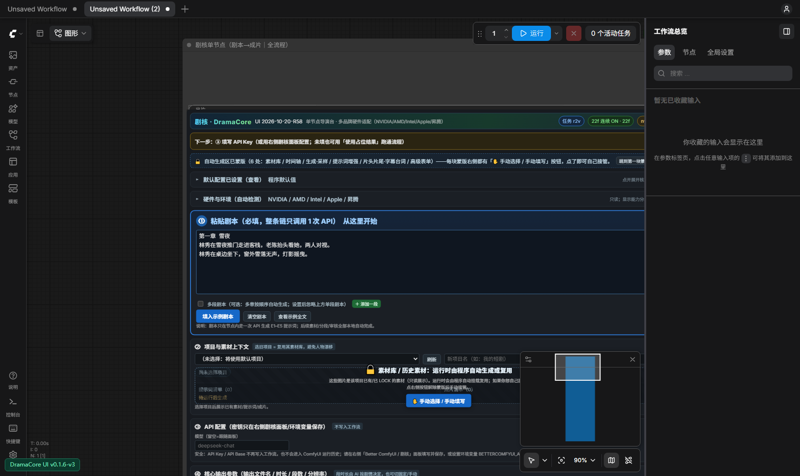
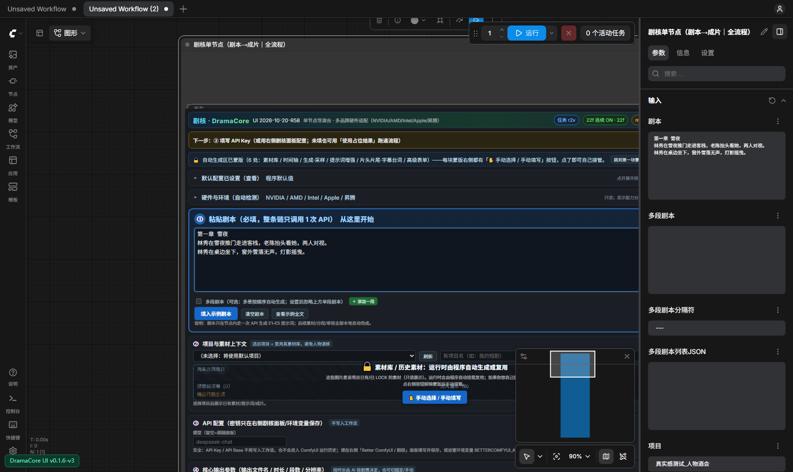

# 剧核 DramaCore（Better ComfyUI）

> **版本：v0.2.0-internal（内测版）** · 许可：**CC BY-NC-SA 4.0**（允许下载/修改/再分发，**禁止商用**；修改后的作品必须以相同许可开源）
> **注意：本项目的默认「统一风格」与系统提示词中的风格锁均为示例模板，部署到你的项目时请自行修改或替换。**

**剧核 DramaCore** 是 ComfyUI 的「剧本进、成片出」大节点：
剧本 → 一次 LLM 调用 → 全部提示词 → 素材图生成/审核/锁定 → H3 导演台出片（段间连续）
→ 段级/整片审核 → 剪辑封装。导演台核心已随包 vendor，不依赖外部自定义节点。

---

## 核心变化（v0.2.0-internal）

- **系统提示词 V3.0「契约对齐」**：`h3_v3_contract` 作为唯一系统提示词（37,457 字），不再自动追加旧规则块；
- **移除自动调色硬校正（colorfix）**：保留模型自然光影，不再把每个镜头强行拉到固定亮度；
- **光影按场景自然决定**：白天自然明亮、夜晚自然偏暗（保留光源与暗部细节）、密室可低照度；禁止一刀切提亮/压暗；
- **「活人感」要求**：真实皮肤纹理、自然光影过渡、呼吸/眨眼等微动作，减少塑料/CG 感；
- **H3 官方提示词格式**：三字段、`[Shot]` 标记、运镜「类型+幅度+速度」、`(S1)(S2)`、`<d>[中文]</d>` 对白；
- **前端自动兼容**：旧工作流参数自动修复，不再弹「参数与插件节点不一致」拦截框；
- **稳定出片参数**：默认【真实参数版】1344×768 / 8 步 / ref2v 8step LoRA；【快速4步版】1152×640 / 4 步。

## 安装（3 分钟）

**推荐用一键安装器**（Windows / Linux / macOS 同一套核心；默认 dry-run 不写文件，确认后加 `-Yes` / `--yes`）：

**1. 获取代码**（git clone 或下载 ZIP）：

```bash
git clone https://github.com/minzzj/DramaCore.git
cd DramaCore
```

ZIP：<https://github.com/minzzj/DramaCore/archive/refs/heads/main.zip>

**2. 先看安装计划**（不写任何文件）：

```powershell
# Windows：把 D:\ComfyUI 换成你的 ComfyUI 路径
powershell -ExecutionPolicy Bypass -File .\install\install_windows.ps1 -Mode attach -ComfyUI "D:\ComfyUI" -DryRun
```
```bash
# Linux / macOS
chmod +x install/install_linux.sh
./install/install_linux.sh --mode attach --comfyui /opt/ComfyUI --dry-run
```

**3. 正式安装**：

```powershell
powershell -ExecutionPolicy Bypass -File .\install\install_windows.ps1 -Mode attach -ComfyUI "D:\ComfyUI" -Yes
```
```bash
./install/install_linux.sh --mode attach --comfyui /opt/ComfyUI --yes
```

安装器会：检测 GPU/后端/显存 → 安装依赖 → 把插件与编排包放到正确位置 → 生成启动器（`start_dramacore.bat` / `.sh`）；**不会下载模型**。

**4. 模型 + API Key + 启动 + 工作流** → 完整步骤见 **[docs/安装指南_用户版.md](docs/安装指南_用户版.md)**。

> 还没有 ComfyUI？用 `-Mode bootstrap` / `--mode bootstrap` 自动准备 ComfyUI（仍不含模型）。
> 想手动安装：见用户指南第 3 节。


## 完整工作流

| 文件（`bettercomfyui_comfy/workflows/`） | 用途 |
|---|---|
| `【新版】剧核_单节点_剧本到成片_快速4步版_20261024.json` | 快速测试（1152×640 / 4 步 / ref2v 4step / 段间连续） |
| `【新版】剧核_单节点_剧本到成片_真实参数版_20261024.json` | 正式出片（1344×768 / 8 步 / ref2v 8step / 段间连续） |
| `00_【单节点】剧本→成片（无外部依赖）.json` | 单节点完整流程（细节参数可改） |
| 其它 `W*/S*/P*/00_*` | 分步体验/素材/审核/剪辑等子流程 |

> 完整说明见 [`docs/工作流说明_完整工作流.md`](docs/工作流说明_完整工作流.md)。

### 实验版工作流（可选 · 公测）

> ⚠️ 实验版用于验证「2×15s / 纯 t2v / 无素材图 / 单次封装」的高质量方案，**不是默认稳定版**。
> 文件：`bettercomfyui_comfy/workflows/【实验版】剧核_单节点_高效画质_2x15s_20261025.json`
> 如果报错或效果回退：**直接重新打开稳定版工作流**（旧文件未改动），无需卸载。
> 说明：[docs/实验版_高效画质工作流.md](docs/实验版_高效画质工作流.md)

## 自定义风格（必须修改！）

**默认风格是示例，请按你的项目自行修改或替换：**

1. 节点「统一风格」参数（推荐）：改成你的项目风格词；
2. 系统提示词 V3.0 的 `PART C · C1 风格锁`：替换为你的风格锁；
3. 导演台面板 →「提示词」→ 可查看/替换当前生效的系统提示词（默认 `h3_v3_contract`）。

详见 [`docs/自定义风格与系统提示词.md`](docs/自定义风格与系统提示词.md)。

## 配置与密钥安全

- 默认配置：[`config/default.yaml`](config/default.yaml)；示例：[`config/user.yaml.example`](config/user.yaml.example)；
- **本仓库不含任何 Token/API Key**；`config/user.yaml` 已被 `.gitignore` 排除；
- 请勿把 Key 写进工作流 JSON、截图或 Issue。

## 许可证

本项目采用 **CC BY-NC-SA 4.0**：
- ✅ 允许下载、查看、修改、非商业再分发；
- ✅ 修改后的作品必须采用相同许可（ShareAlike）并保留署名（Attribution）；
- ❌ 不允许商业使用（NonCommercial）。
- 注意：因含「禁止商用」条款，本许可**不是 OSI 定义的开源许可**，属于「源码可见 + 非商业共享」许可。

完整法律文本见 [LICENSE](LICENSE)。

## 运行截图






## 宣传片

- 🎬 **成片帧版（推荐，48 秒）**：[BGM 版](https://github.com/minzzj/DramaCore/releases/download/v0.2.0-internal/DramaCore-promo-fast2-48s-bgm.mp4) · [静音版](https://github.com/minzzj/DramaCore/releases/download/v0.2.0-internal/DramaCore-promo-fast2-48s-silent.mp4) · [封面](https://github.com/minzzj/DramaCore/releases/download/v0.2.0-internal/DramaCore-promo-fast2-poster.jpg)
- 说明：[docs/宣传片_快节奏版.md](docs/宣传片_快节奏版.md)

## 文档

- [安装部署](docs/ROUND57_安装部署指南.md)
- [工作流说明（完整）](docs/工作流说明_完整工作流.md)
- [自定义风格与系统提示词](docs/自定义风格与系统提示词.md)
- [面板配置说明](docs/剧核_DramaCore_面板配置说明.md)
- [发布说明 v0.2.0](docs/发布说明_v0.2.0-internal.md)
- [更新日志](CHANGELOG.md)
