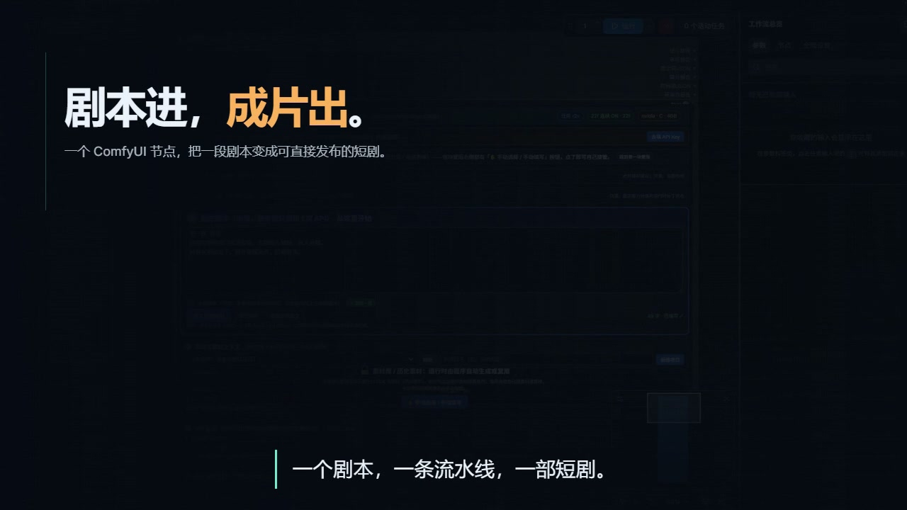
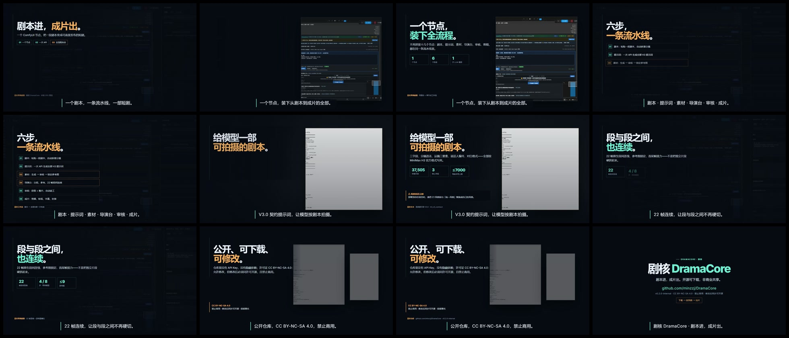

# 宣传片 · 剧核 DramaCore（68 秒）

成片（GitHub Release 下载）：
- [BGM 版（1280×720 / 30fps / 68s）](https://github.com/minzzj/DramaCore/releases/download/v0.2.0-internal/DramaCore-promo-68s-bgm.mp4)
- [静音版](https://github.com/minzzj/DramaCore/releases/download/v0.2.0-internal/DramaCore-promo-68s-silent.mp4)
- [封面](https://github.com/minzzj/DramaCore/releases/download/v0.2.0-internal/DramaCore-promo-poster.jpg)
- [关键帧总览](https://github.com/minzzj/DramaCore/releases/download/v0.2.0-internal/DramaCore-promo-contact-sheet.jpg)

项目工程：`代码视频/dramacore-promo`（HyperFrames + GSAP；Python/NumPy BGM；真实截图）。

## 结构
| 时间 | 段落 |
|---|---|
| 0:00–0:08 | 冷开场：剧本进，成片出 |
| 0:08–0:18 | 一个节点，装下全流程 |
| 0:18–0:30 | 六步流水线 |
| 0:30–0:40 | V3.0 契约提示词 |
| 0:40–0:50 | H3 导演台 / 22 帧连续 |
| 0:50–1:00 | 公开仓库 + CC BY-NC-SA 4.0 |
| 1:00–1:08 | 收尾：仓库地址 / 版本 |

> 素材来自真实运行界面/真实文件；无伪造；无旁白；BGM 为代码合成。
> 许可：CC BY-NC-SA 4.0（禁止商用；修改后同许可开源）。
