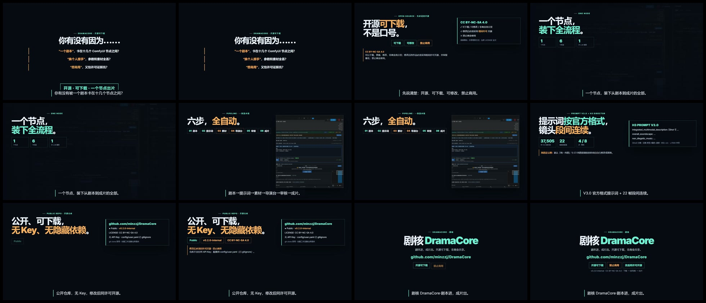

# 宣传片 · 快节奏版（48 秒）

开头钩子 + 强调开源的 48 秒版：1280×720 / 30fps / 无旁白 / 代码合成 BGM。

## 下载
- [BGM 版](https://github.com/minzzj/DramaCore/releases/download/v0.2.0-internal/DramaCore-promo-fast-48s-bgm.mp4)
- [静音版](https://github.com/minzzj/DramaCore/releases/download/v0.2.0-internal/DramaCore-promo-fast-48s-silent.mp4)
- [封面](https://github.com/minzzj/DramaCore/releases/download/v0.2.0-internal/DramaCore-promo-fast-poster.jpg)
- [关键帧总览](https://github.com/minzzj/DramaCore/releases/download/v0.2.0-internal/DramaCore-promo-fast-contact-sheet.jpg)

## 结构
| 时间 | 内容 |
|---|---|
| 0–6s | 钩子三连问 + 「开源·可下载·一个节点出片」 |
| 6–12s | 明确开源：可下载/可修改/禁止商用；修改后同许可开源（CC BY-NC-SA 4.0） |
| 12–19s | 一个节点装下全流程 |
| 19–26s | 六步流水线 |
| 26–33s | V3.0 官方格式提示词 + 22 帧连续 + 风格自行替换提醒 |
| 33–40s | 公开仓库/无 Key/版本/许可证 |
| 40–48s | CTA：github.com/minzzj/DramaCore |

> 素材来自真实运行界面/真实文件；无旁白；BGM 代码合成；无隐私信息。
> 许可：CC BY-NC-SA 4.0（禁止商用；修改后同许可开源）。
