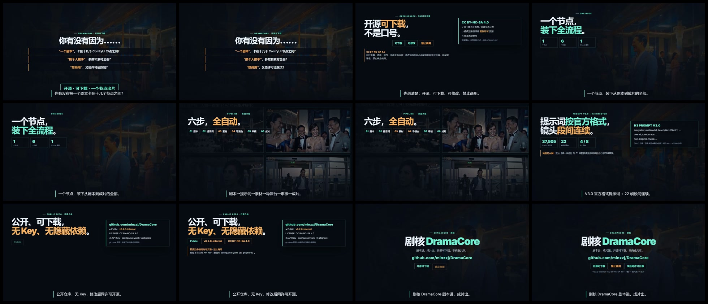

# 宣传片 · 快节奏版（成片帧版，48 秒）

1280×720 / 30fps / 48s / 无旁白 / 代码合成 BGM。开头钩子 + 前 12 秒明确开源，用真实成片分析帧制作。

## 下载

- [BGM 版](https://github.com/minzzj/DramaCore/releases/download/v0.2.0-internal/DramaCore-promo-fast2-48s-bgm.mp4)
- [静音版](https://github.com/minzzj/DramaCore/releases/download/v0.2.0-internal/DramaCore-promo-fast2-48s-silent.mp4)
- [封面](https://github.com/minzzj/DramaCore/releases/download/v0.2.0-internal/DramaCore-promo-fast2-poster.jpg)
- [关键帧总览](https://github.com/minzzj/DramaCore/releases/download/v0.2.0-internal/DramaCore-promo-fast2-contact-sheet.jpg)

## 结构

| 时间 | 内容 |
|---|---|
| 0–6s | 钩子三连问 + 「开源·可下载·一个节点出片」 |
| 6–12s | 明确开源：可下载/可修改/禁止商用；修改后同许可开源 |
| 12–19s | 一个节点装下全流程 |
| 19–26s | 六步流水线 + 真实成片人物一致性 4 帧 |
| 26–33s | V3.0 官方格式提示词 + 22 帧连续 + 风格自行替换提醒 |
| 33–40s | 公开仓库 / 无 Key / 版本 / 许可证 |
| 40–48s | CTA：github.com/minzzj/DramaCore |

## 素材说明

- 人物一致性 4 帧来自 147 秒完整片（5s/40s/80s/120s 抽样），已裁掉播放器控制条；
- 其余为明亮版 / colorfix 版分析帧；
- 仅用于宣传演示，不代表所有功能默认开关。

## 许可

CC BY-NC-SA 4.0（禁止商用；修改后同许可开源）。
